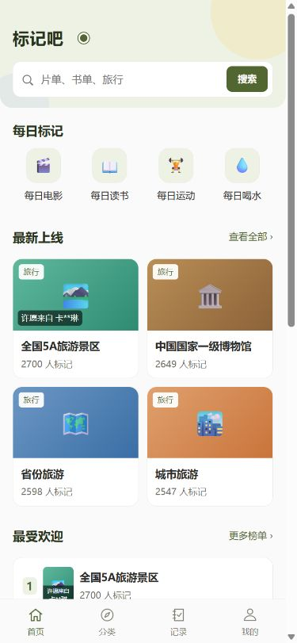
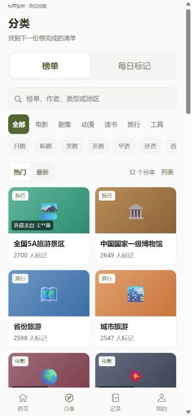
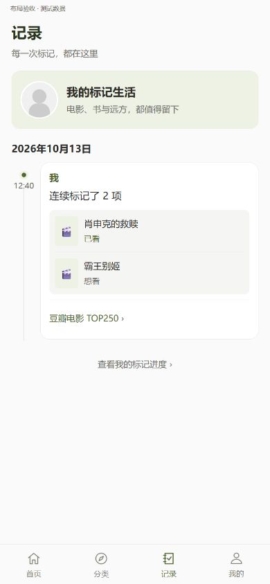
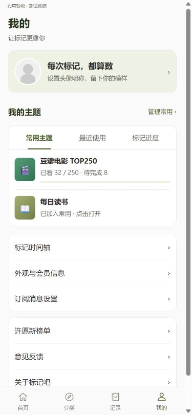

# 四个标签页 UI 优化

本轮保留现有四套配色，统一字号层级、页面留白、卡片圆角、边框和交互区域。浅色背景与深色强调文字分开定义，改善粉色、浅沙色主题的可读性。

- 首页：淡色头图区、清晰的搜索入口、统一每日标记图标与主题卡片。
- 分类：突出“榜单 / 每日标记”两大入口；单行可横滑分类；排序、结果数与视图切换分组。
- 记录：强化日期与时间轴层级，分组展示连续／批量标记，补齐无封面占位，提供跳转个人进度的入口。
- 我的：资料、个人主题、设置分区；常用主题／最近使用／标记进度统一为分段导航，直接继承原置顶数据。

## 验证

- 39 项导航、时间轴及云端逻辑回归测试通过。
- 使用微信 WXML／WXSS 编译器检查四页及四套配色。
- 浏览器布局预览检查 390px 与 320px 视口、长昵称与标题、空时间轴、列表视图、每日标记视图。四个主页无整体横向溢出。
- 下方为实际模板编译后使用测试数据的浏览器预览，不是微信真机截图；尚未进行真机验收或云端部署。

## 四页预览

### 首页

### 分类

### 记录

### 我的

